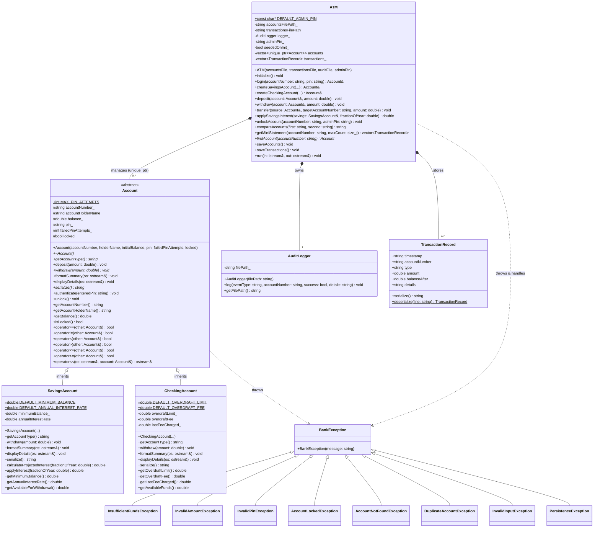

# Class Diagram / الرسم التخطيطي للفئات

This document illustrates the Object-Oriented Architecture of the **Bank Account & ATM Transaction Simulator**, highlighting inheritance, polymorphism, composition, and exception dependencies across `Account`, `SavingsAccount`, `CheckingAccount`, `ATM`, `AuditLogger`, `TransactionRecord`, and the `BankException` hierarchy.

يوضح هذا المستند البنية الكائنية (OOP) لمحاكي المعاملات البنكية والصراف الآلي، بما في ذلك علاقات الوراثة، التعدد الشكلي (Polymorphism)، الاحتواء (Composition)، ونظام الاستثناءات المخصصة.

---

## UML Class Diagram (Mermaid)

---

## Relationships Summary / ملخص العلاقات

| Relationship | Classes | Description (EN) | الوصف (AR) |
| :--- | :--- | :--- | :--- |
| **Inheritance** | `SavingsAccount`, `CheckingAccount` $\rightarrow$ `Account` | Derived classes implement specialized `withdraw()`, `displayDetails()`, `formatSummary()`, and `serialize()`. | الفئات المشتقة ترث الخصائص المشتركة وتعيد تعريف السحب وعرض التفاصيل بتعدد شكلي. |
| **Composition** | `ATM` $\rightarrow$ `Account` (`unique_ptr`) | `ATM` owns and manages the lifecycle of polymorphic accounts loaded from or saved to `accounts.txt`. | تدير فئة `ATM` دورة حياة جميع الحسابات المحملة والمحفوظة في `accounts.txt`. |
| **Composition** | `ATM` $\rightarrow$ `AuditLogger` | `ATM` logs every successful and failed login, transaction, lockout, and validation error to `audit.txt`. | تسجل `ATM` جميع العمليات الناجحة والفاشلة بالطابع الزمني في `audit.txt`. |
| **Composition** | `ATM` $\rightarrow$ `TransactionRecord` | `ATM` records and persists structured account movements to `transactions.txt` for Mini-Statements. | تحفظ `ATM` حركات كل حساب في `transactions.txt` لعرض كشف الحساب المختصر. |
| **Dependency** | `ATM`, `Account` hierarchy $\rightarrow$ `BankException` | Domain and input errors raise typed exceptions derived from `std::runtime_error`. | تُرمى استثناءات مخصصة عند تجاوز الرصيد أو إدخال قيم سالبة أو أخطاء PIN أو المدخلات غير الرقمية. |

> [!TIP]
> A standalone PlantUML version is also available in [`class_diagram.puml`](class_diagram.puml).

